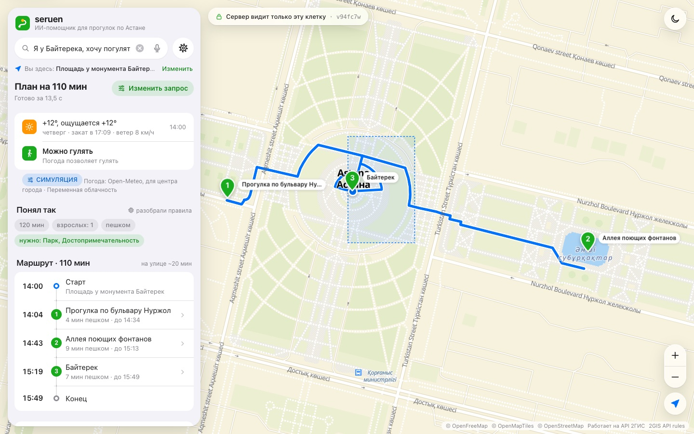
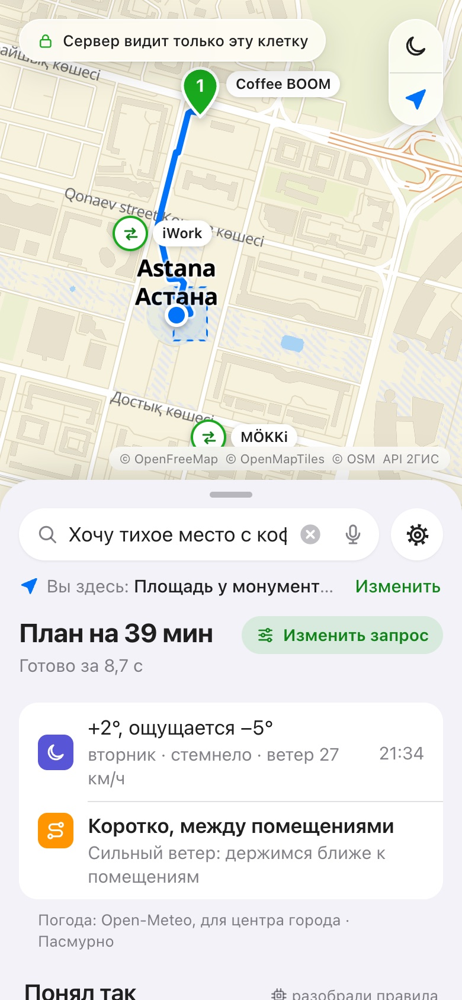
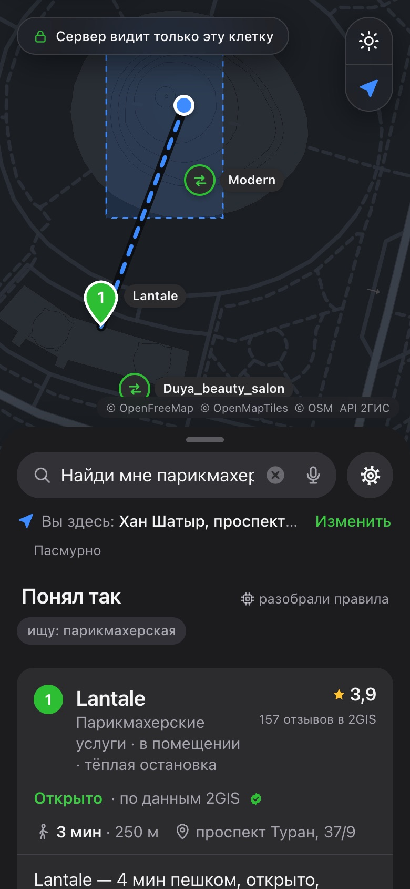
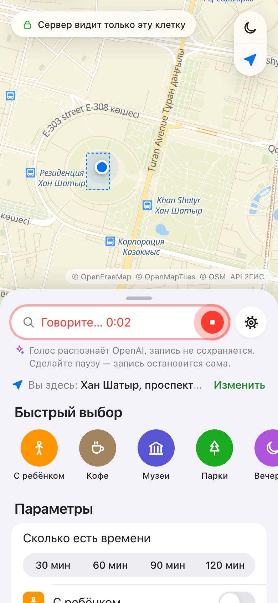
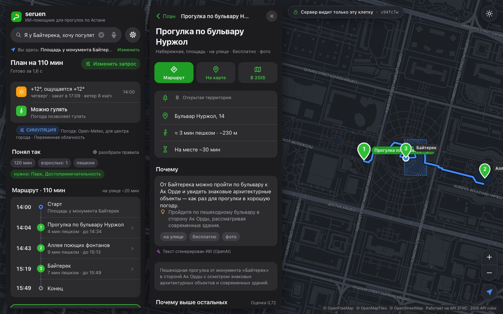
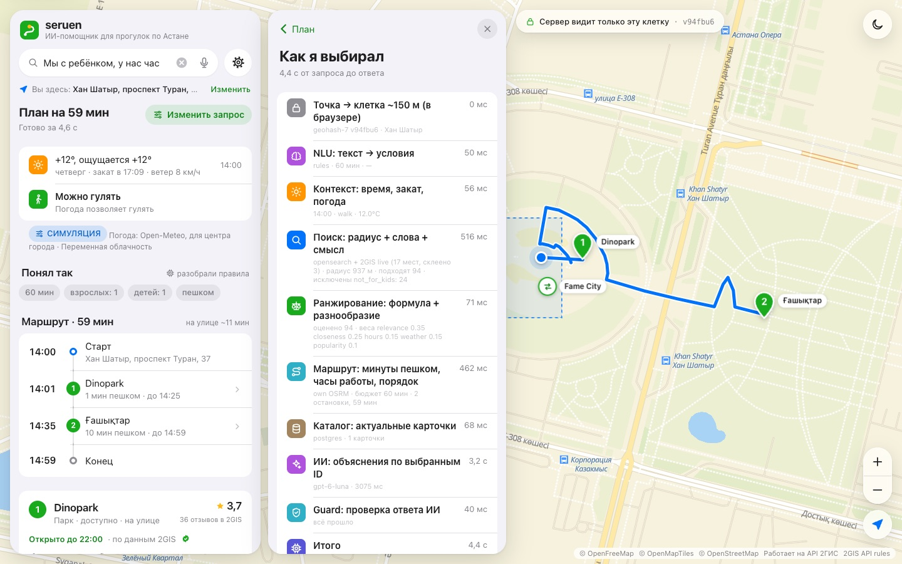
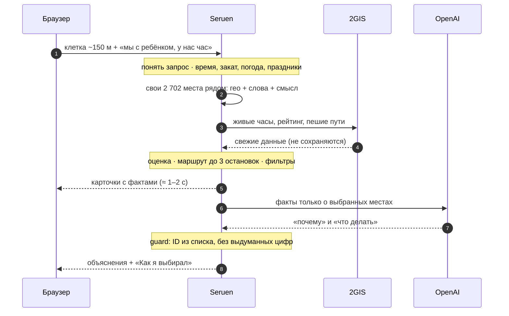
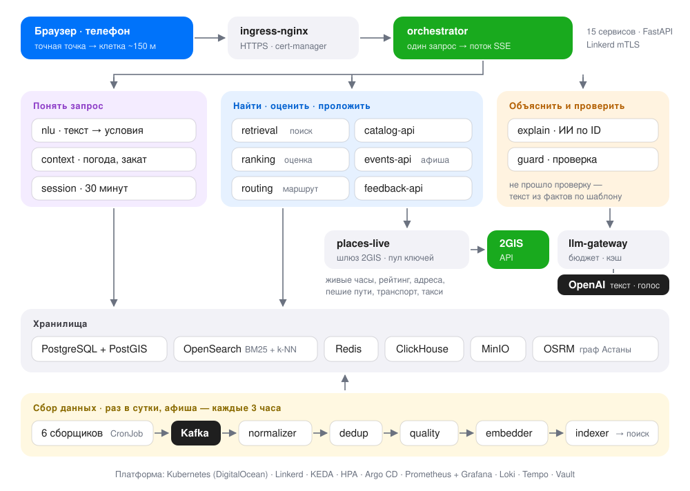

<div align="center">


# Seruen

**ИИ-помощник для прогулок по Астане: куда сходить в ближайшие 30–120 минут — и честно, почему именно туда**

*seruen* (каз.) — прогулка · кейс НИЦ Smart City · GDG Astana «Build with AI» 2026

[](https://github.com/awzwz/seruen-astana/actions/workflows/ci.yml)


### [Открыть демо →](https://seruen.129-212-254-180.sslip.io)

</div>



---

**Содержание:** [Что это](#что-это) · [Что умеет](#что-умеет) · [Как выглядит](#как-это-выглядит) · [Как работает](#как-это-работает) · [Архитектура](#архитектура) · [Данные](#данные) · [Тест-сценарии](#качество-тест-сценарии) · [Приватность](#приватность-и-этика) · [Запуск](#запуск) · [Структура](#структура-репозитория)

## Что это

Человек пишет или говорит, что хочет: «мы с ребёнком, у нас час», «тихое место с кофе и розеткой», «2 часа до вылета», «найди парикмахерскую». Seruen за пару секунд отвечает **1–3 местами или маршрутом**: сколько идти, сколько там пробыть, открыто ли к приходу и почему это подходит именно сейчас — с учётом времени, погоды, заката и праздников Казахстана.

Главный принцип — **код считает, ИИ объясняет**. Расстояния, часы работы, погоду и маршрут считает код. Языковая модель только понимает свободный текст и пишет «почему» про места, которые уже выбрал код. Выдумать место она не может: в схеме её ответа ID задан перечнем кандидатов, а отдельный сервис `guard` проверяет каждый ответ и при сомнении заменяет текст шаблоном из фактов.

## Что умеет

| | |
|---|---|
| 🚶 **Прогулки и маршруты** | 1–3 места или мини-маршрут до 3 остановок по реальным пешеходным путям 2GIS: время в пути, время на месте, «свободны в 15:49». |
| 🔎 **Любое место рядом** | «Найди парикмахерскую», «где поесть плов», «ближайший Magnum», «нужен банкомат» — поиск по всему справочнику 2GIS. На то, чего нет («ремонт летающих тарелок»), — честное «не нашёл», а не случайное кафе. |
| 🌦 **Контекст Астаны** | Время UTC+5, закат, праздники РК, ощущаемая температура и ветер → «можно гулять / коротко между тёплыми местами / лучше в помещении». В мороз ведёт от тепла к теплу. |
| 🕐 **Честные часы работы** | «Открыто до 22:00 · по данным 2GIS ✓», «по OSM 12.2025 — уточните», «часы неизвестны — не обещаем, что открыто». Закрытые к приходу места не предлагаются. |
| 👨‍👩‍👧 **Под людей** | С ребёнком (без баров и тёмных парков), на коляске, группа, турист, «потом в аэропорт» — с такси по пробкам и автобусом + LRT из 2GIS. |
| 🎙 **Голосом** | Микрофон в поле поиска: сказали — запись остановилась на паузе — текст в поле — подбор. OpenAI `gpt-4o-transcribe`, русский и казахский. Голос не сохраняется. |
| 🧭 **«Как я выбирал»** | Все шаги с временем, формула оценки, что ушло в ИИ, что в 2GIS и что не уходило никуда. |
| 🌐 **Три языка, две темы** | Русский, казахский, английский. Светлая и тёмная тема. Сайт и телефон. |
| 🔒 **Приватность** | Точная точка не покидает телефон — сервер видит клетку ~150 м. «Режим без ИИ» и «Удалить мои данные» в один тап. |

## Как это выглядит

Интерфейс в цветах 2GIS по правилам Apple Human Interface Guidelines: на телефоне — карта и шторка снизу с тремя положениями, на компьютере — плавающая панель и вторая колонка для деталей.

<table>
<tr>
<td width="33%"></td>
<td width="33%"></td>
<td width="33%"></td>
</tr>
<tr>
<td align="center"><sub>«Тихое место с кофе и розеткой»</sub></td>
<td align="center"><sub>«Найди мне парикмахерскую» · тёмная тема</sub></td>
<td align="center"><sub>Голосовой ввод</sub></td>
</tr>
</table>

<table>
<tr>
<td width="50%"></td>
<td width="50%"></td>
</tr>
<tr>
<td align="center"><sub>Карточка места: «почему», часы с уровнем доверия, оценка по признакам</sub></td>
<td align="center"><sub>«Как я выбирал»: каждый шаг и его время</sub></td>
</tr>
</table>

## Как это работает

Это RAG: **Retrieval** — поиск по своей базе мест и живому 2GIS, **Augmentation** — код добавляет время, погоду, часы работы и строит маршрут, **Generation** — ИИ пишет объяснение про уже выбранные места.



**Оценка места:** `0,35·подходит под запрос + 0,25·близость + 0,15·уверенность в часах + 0,15·погода + 0,10·популярность`, затем разнообразие — не три кофейни подряд.

Ответ приходит потоком (SSE): карточки с фактами появляются через 1–2 секунды, текст ИИ дописывается следом. Если ИИ не уложился в 8 секунд или ответ не прошёл проверку, текст собирается шаблоном из тех же фактов.

Запрос на **конкретное место** («аптека», «плов») короче: поиск по всему справочнику 2GIS вокруг клетки с расширением радиуса 1,5 → 4 → 10 км, ближайшее открытое место и два запасных, текст из фактов без ИИ.

## Архитектура

15 онлайн-сервисов и 9 фоновых воркеров в одном кластере DigitalOcean Kubernetes. Один Docker-образ на все роли, роль задаёт переменная `SERVICE`. Тот же код запускается и одним процессом (`make dev`) — для разработки и демо без кластера.



| Слой | Что |
|---|---|
| Сервисы | orchestrator, session, context, nlu, retrieval, ranking, routing, explain, guard, llm-gateway, catalog-api, events-api, feedback-api, partner-portal, places-live |
| Воркеры | 6 сборщиков (CronJob), normalizer, dedup, quality, enrich, embedder, indexer, verifier (Celery), analytics |
| Шина | Kafka (Strimzi, KRaft), 10 топиков, DLQ |
| Хранилища | PostgreSQL + PostGIS (CloudNativePG), OpenSearch, Redis, ClickHouse, MinIO, свой OSRM по карте Астаны |
| Платформа | Linkerd (mTLS), KEDA, HPA, Argo CD, Prometheus + Grafana, Loki, Tempo (OpenTelemetry), cert-manager, Vault |
| ИИ | OpenAI `gpt-6-luna` (≈ $0,0007 за ответ), эмбеддинги `text-embedding-3-large` (1024), голос `gpt-4o-transcribe` |

Подробно — в [docs/ARCHITECTURE.md](docs/ARCHITECTURE.md) и [docs/CONTRACTS.md](docs/CONTRACTS.md).

## Данные

Своя база собирается автоматически: CronJob по каждому источнику → Kafka → нормализация → склейка дублей → оценка качества → эмбеддинги → OpenSearch.

| Что | Сколько |
|---|---|
| Мест после склейки дублей | **2 702** |
| Подтверждены двумя источниками и больше | 315 |
| Событий из афиши | 97 |

| Источник | Что даёт | Лицензия |
|---|---|---|
| OpenStreetMap | основа: координаты, категории, часы, доступность | ODbL |
| Overture Maps | дополнительные заведения | CDLA / по источникам |
| Wikidata | названия на трёх языках, популярность | CC0 |
| Wikivoyage | описания «что посмотреть» | CC BY-SA |
| visitastana.kz | курированные подборки, коворкинги | со ссылкой |
| sxodim.com | афиша событий | со ссылкой |

У каждого поля записаны источник, дата и уверенность. **Живой слой 2GIS** добавляется в момент запроса — свежие часы, рейтинг, отзывы, адреса, пешие маршруты, транспорт и такси — и **ничем не сохраняется**, как требуют правила 2GIS API. Ключи 2GIS работают пулом: система считает расход каждого ключа и при исчерпании лимита переключается на следующий.

## Качество: тест-сценарии

Каждый сценарий прогоняется автоматически (`make eval`), каждая проверка — код, а не ручная оценка: нет мест, закрытых к приходу; нет слова «открыто» без данных; маршрут укладывается в бюджет; в тексте ИИ нет выдуманных цифр; язык ответа совпадает с запросом и другие.

**18 из 18 сценариев, 141 из 141 проверки.** На живом кластере — 17 из 17 (сценарий 15 подменяет данные места и запускается только локально).

| # | Сценарий | |
|---|---|:-:|
| 1 | Mega Silk Way, прогулка 30–60 минут днём | ✅ |
| 2 | Турист, 2 часа до вылета (en) — такси до NQZ | ✅ |
| 3 | Хан Шатыр, 18:30, с ребёнком, холодно (kk) | ✅ |
| 4 | Тихое место с кофе и розеткой | ✅ |
| 5 | Необычная ночная активность, четверг 23:30 | ✅ |
| 6 | Пользователь на инвалидной коляске у Байтерека | ✅ |
| 7 | Группа из 4 человек, разные интересы | ✅ |
| 8 | Перенесённый выходной 26.10 | ✅ |
| 9 | EXPO, «что-то необычное на 1–2 часа» — пример из кейса | ✅ |
| 10 | Старые названия: «Нур Алем», «Думан» | ✅ |
| 11 | События сегодня вечером (афиша) | ✅ |
| 12 | Мороз −25 °C и сильный ветер | ✅ |
| 13 | Режим без ИИ | ✅ |
| 14 | Время Астаны UTC+5 без симулятора | ✅ |
| 15 | Инструкция внутри описания места игнорируется | ✅ |
| 16 | «Найди парикмахерскую» — весь справочник 2GIS | ✅ |
| 17 | «Где поесть плов» | ✅ |
| 18 | «Ремонт летающих тарелок» — честное «не нашёл» | ✅ |

Полные отчёты с ответами системы: [локально](docs/TEST_SCENARIOS.md) · [на кластере](docs/TEST_SCENARIOS_cluster.md).

## Приватность и этика

- **Точка остаётся на телефоне.** Браузер сам превращает её в клетку geohash ~96 × 152 м и отправляет только клетку; расстояния пересчитывает по точной точке у себя.
- **В ИИ** уходят текст запроса, фильтры, режим погоды и факты о 1–3 местах. **В 2GIS** — центр клетки и тип места. **Никуда** — координаты, история, ID и IP. Всё это видно в панели «Как я выбирал».
- **Голос** распознаётся и сразу удаляется — ни на сервере, ни в кэше, ни в логах.
- **Аналитика для города** — только ячейка H3 (≈ 0,7 км²), час и категории; ячейка показывается при ≥ 20 запросах.
- **Закон РК «Об искусственном интеллекте»:** тексты ИИ помечены, есть «Режим без ИИ» (ст. 16), подсказка — не решение (ст. 17).

Подробно — в [docs/ETHICS.md](docs/ETHICS.md).

## Запуск

Нужны Python 3.12 и ключ OpenAI. Ключ 2GIS необязателен: без него система работает на своей базе.

```bash
git clone https://github.com/awzwz/seruen-astana.git && cd seruen-astana

# 1. окружение
python3.12 -m venv .venv && . .venv/bin/activate
pip install -r requirements.txt
cp .env.example .env              # впишите OPENAI_API_KEY (и DGIS_API_KEYS, если есть)

# 2. база мест (≈ 3–4 мин: сбор из 6 источников, склейка, эмбеддинги)
make ingest

# 3. вся система одним процессом → http://localhost:8000
make dev

# 4. проверки
make test                         # юнит-тесты
make eval                         # 18 сценариев → docs/TEST_SCENARIOS.md
```

**Без ключей и сети:** откройте `http://localhost:8000/?mock=1&auto=1` — сайт проиграет записанный ответ сервера.

**Кластер:** `bash deploy/scripts/bootstrap.sh` поднимает платформу (Kafka, базы, наблюдаемость, Linkerd, Argo CD), затем `make build && kubectl apply -k deploy/apps`. Пошагово — в [deploy/README.md](deploy/README.md).

## Структура репозитория

```
seruen/
├── common/      контракты (models.py), конфиг, геометрия, вызовы между сервисами
├── engine/      логика: часы работы, контекст, разбор запроса, оценка, маршрут, шаблоны
├── services/    15 онлайн-сервисов (FastAPI) и пул ключей 2GIS
├── workers/     9 воркеров Kafka / Celery и задачи сбора
└── ingest/      сборщики 6 источников, нормализация, склейка дублей, качество, эмбеддинги
web/             интерфейс: MapLibre + OpenFreeMap, ru / kk / en, светлая и тёмная тема
deploy/          Helm-values платформы, манифесты приложения (Kustomize), скрипты
tools/           прогон тест-сценариев
tests/           юнит-тесты
docs/            архитектура, контракты, этика, отчёты сценариев
design/          как искали интерфейс
```

| Документ | О чём |
|---|---|
| [ARCHITECTURE.md](docs/ARCHITECTURE.md) | RAG простыми словами, путь запроса, данные, развёртывание, ограничения |
| [CONTRACTS.md](docs/CONTRACTS.md) | сервисы и их API, топики Kafka, хранилища, поток SSE |
| [ETHICS.md](docs/ETHICS.md) | местоположение, закон РК об ИИ, недостоверные данные, безопасность |
| [TEST_SCENARIOS.md](docs/TEST_SCENARIOS.md) | сценарии с ответами системы и итогами проверок |
| [deploy/README.md](deploy/README.md) | как поднять кластер с нуля |

---

<sub>Код — под лицензией [MIT](LICENSE). Данные: © участники OpenStreetMap (ODbL), Wikidata (CC0), Wikivoyage (CC BY-SA), Overture Maps, visitastana.kz, sxodim.com; погода — Open-Meteo (CC BY 4.0); карта — © OpenFreeMap, © OpenMapTiles. Живые данные — [API 2ГИС](https://dev.2gis.ru), не хранятся. Демо-кластер работает на время хакатона.</sub>
